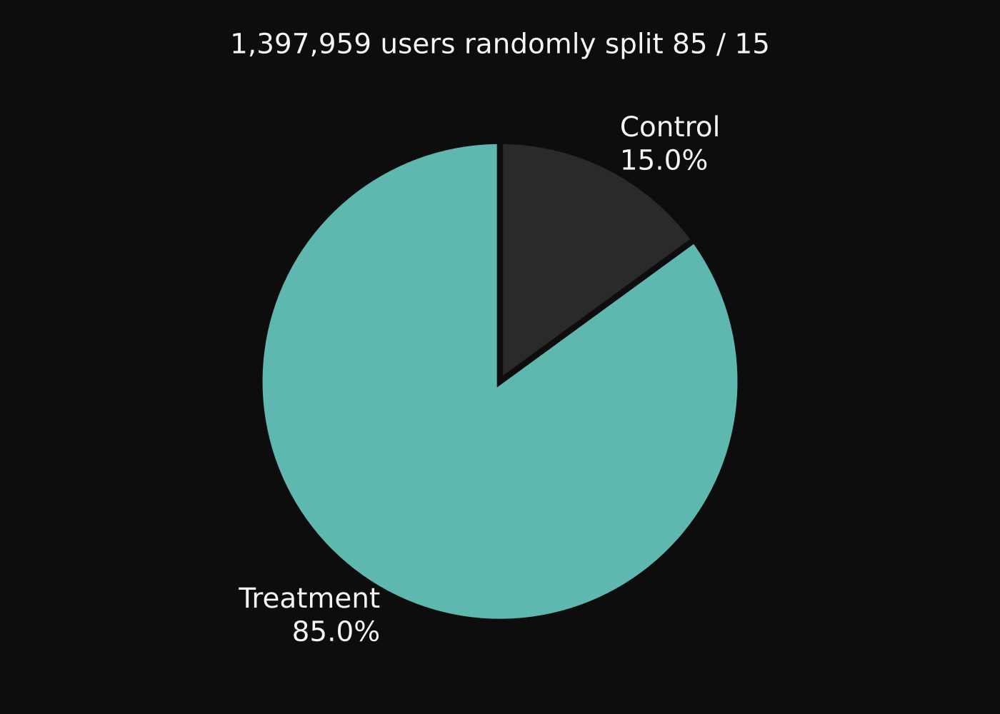
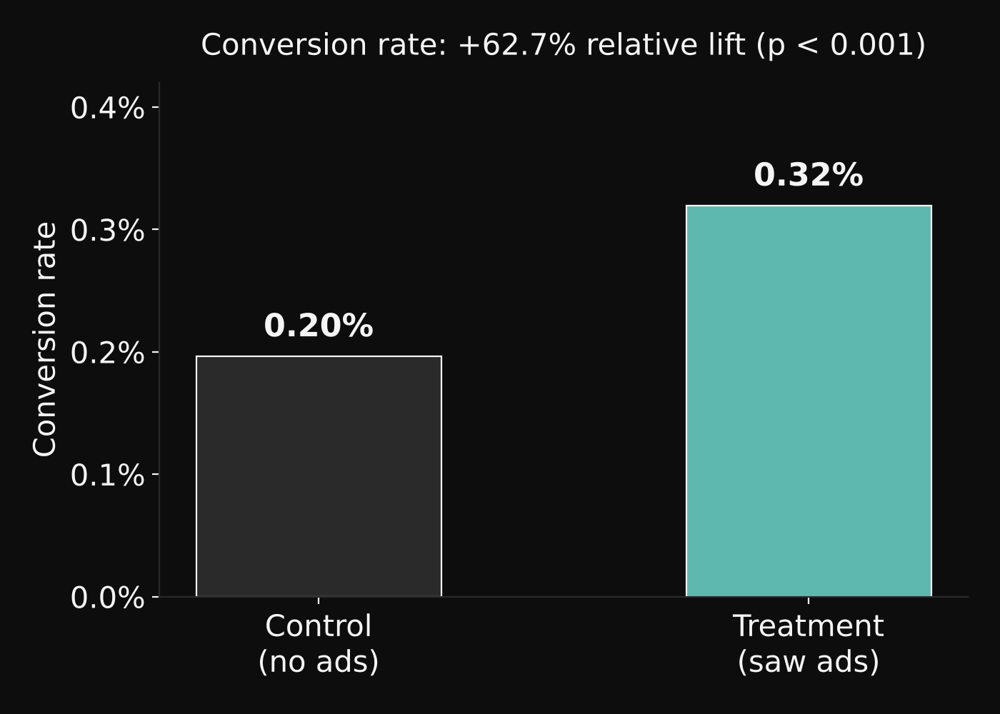
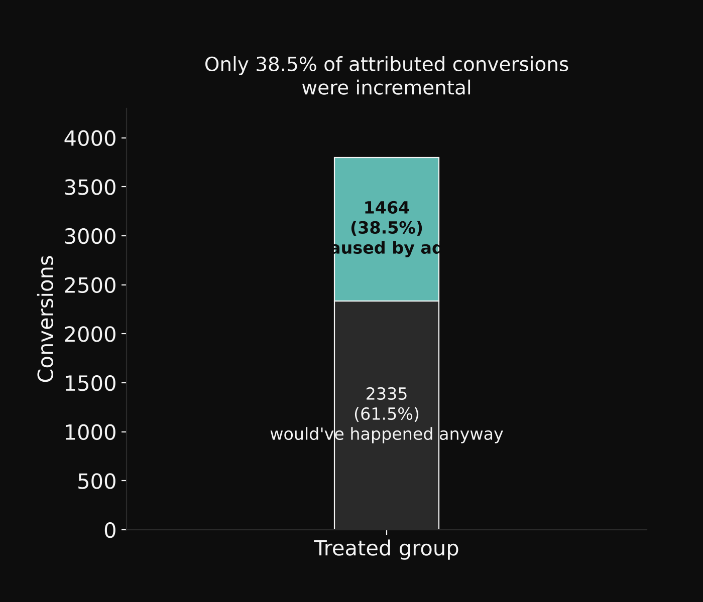
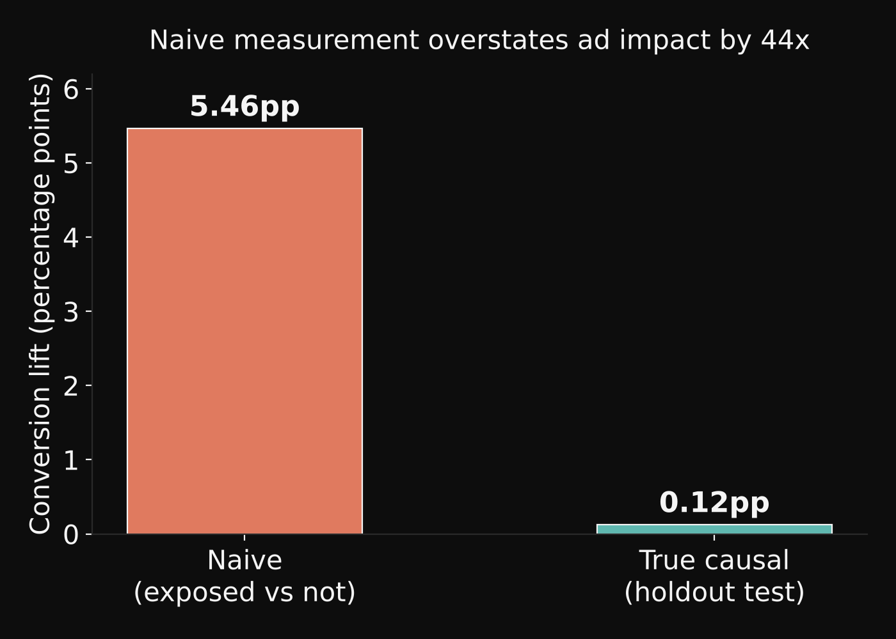

# Incrementality Study: Did the Ads Actually Work? (Criteo)

**The business question:** We ran display ads to 85% of users and held out 15% as a control. Did the ads cause extra visits and conversions, and was it worth it?

This project uses a real randomized ad experiment (the [Criteo Uplift Prediction Dataset](https://ailab.criteo.com/criteo-uplift-prediction-dataset/), 13.9M users) to separate **incrementality** (what a randomized holdout proves) from **attribution** (what a platform dashboard reports) — and shows how far apart those two numbers can be.

## The experiment

- 13,979,592 users, randomly split 85% treatment (could see ads) / 15% control (ads withheld)
- Confirmed random: all 12 anonymized pre-campaign features are balanced between groups
- A 10% sample (1,397,959 users, seed=42) was used for the analysis below

## Headline result

Conversion rate rose from **0.20%** (control) to **0.32%** (treatment) — a **62.7% relative lift**, statistically significant (p < 0.001, 95% CI [0.10pp, 0.14pp]).

## Business impact

Of the 3,799 conversions in the treated group, only **1,464 (38.5%)** were truly caused by the ads — the other 61.5% would have happened anyway. At an assumed $5 CPM and $40/conversion (stated assumptions, not real cost data), this implies an **iROAS of 9.85**.

## The trap (why dashboards overstate ad impact)

A naive analyst comparing "users who saw the ad" vs. "users who didn't" — both inside the treatment group — would conclude a 5.46 percentage-point lift. The true causal lift, measured against the randomized holdout, is only 0.12 percentage points.

**The naive method overstates the ad's impact by 44x.**

This happens because users who were actually shown ads were already more engaged (more page views, more logged-in sessions) — a selection bias that has nothing to do with the ads. Comparing exposed vs. non-exposed users inside one group mixes "the ad's effect" with "this user was already more likely to convert." The randomized holdout avoids this entirely by comparing two groups that were assigned by coin flip, not by behavior.

## Recommendations

1. **Keep the campaign.** The lift is real, statistically significant, and profitable.
2. **Report incremental CPA, not attributed CPA**, to leadership — attribution overcounts by roughly 2.6x here.
3. **Maintain a permanent 10–15% holdout** on every future campaign to keep measuring true causal lift, not platform-reported numbers.

## Limits

- Criteo's 12 features (f0–f11) are anonymized; no business interpretation of individual features is possible.
- CPM ($5) and conversion value ($40) are illustrative assumptions, not real cost/revenue data (the dataset includes neither).
- Analysis uses a 10% random sample of the full 14M-row dataset for speed; results are consistent with Criteo's published full-dataset benchmarks.

## Methodology

- Two-proportion z-test and 95% confidence interval (`statsmodels`) for significance testing
- Balance check across all 12 pre-campaign features to validate randomization
- Naive vs. true lift comparison to quantify selection bias in standard attribution

## Stack

Python, pandas, statsmodels, matplotlib

## Reference

Diemert, E., Betlei, A., Renaudin, C., & Amini, M-R. (2018). *A Large Scale Benchmark for Uplift Modeling.* Proceedings of the AdKDD and TargetAd Workshop, KDD 2018.

---
Built by [Mohammed Faisal Khan](https://firesal.vercel.app) as part of an ad-tech analytics portfolio.
